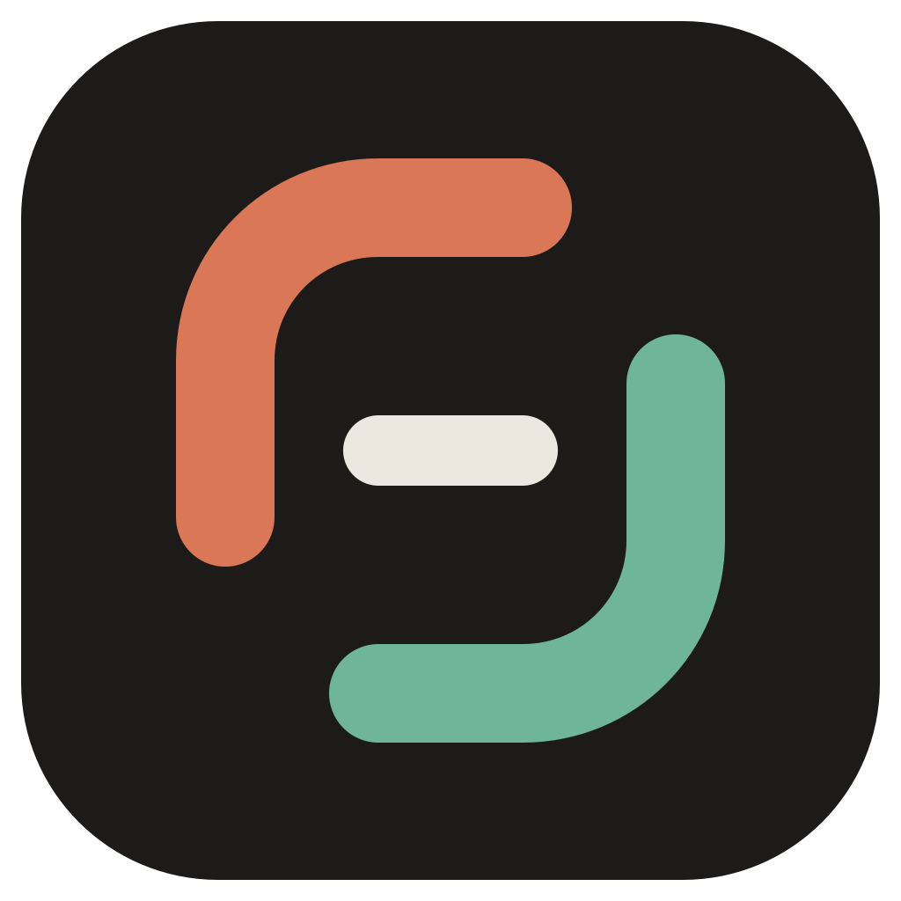
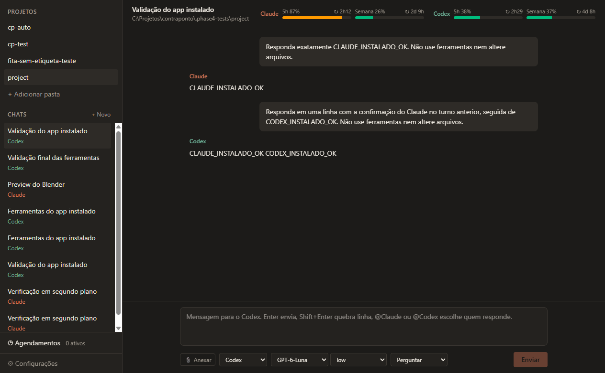
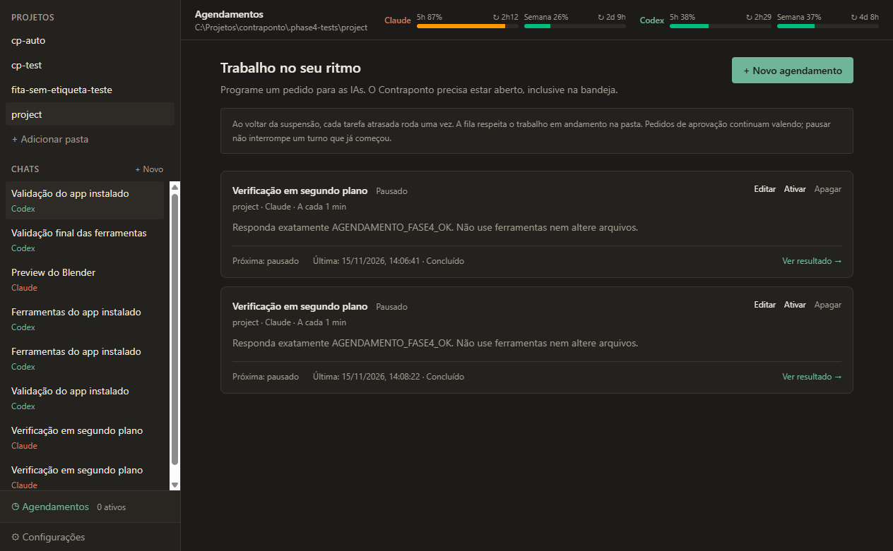

# Contraponto



**Claude Code e Codex, no mesmo chat e na mesma pasta de projeto.** Um app desktop para Windows, com interface em português, que combina código, planejamento e trabalho visual.

- Escolha **Claude**, **Codex** ou **Automático**. No Automático, o Claude lidera e delega ao Codex conforme a tabela “Quem faz o quê”.
- Troque de IA sem recontar o trabalho: cada uma recebe um resumo do que a outra fez.
- Veja streaming, ferramentas, aprovações, imagens e as cotas de 5 horas e da semana.
- Abra imagens em tela cheia, com zoom e arraste. Anexe imagens e arquivos aos pedidos.
- Use **Desfazer turno** para restaurar os arquivos do último turno pelo repositório-sombra, separado do Git do projeto.
- Programe tarefas por intervalo, cron com fuso ou data única; deixe o app trabalhando na bandeja.
- Gere previews de modelos com o Blender sem guardar arquivos temporários no projeto.





## Pré-requisitos

- **Windows x64** e **Git** disponível no PATH (usado pelos checkpoints).
- **Claude Code oficial instalado e autenticado** na conta/plano do próprio usuário. O Agent SDK incluído executa o Claude Code oficial com essa autenticação; não é necessário configurar uma chave de API no Contraponto.
- **Login do ChatGPT para o Codex**. O executável do Codex vem junto com o app, na versão fixada pelo projeto; não é preciso instalar um Codex global. Ele reutiliza a autenticação do Codex CLI/app do seu perfil do Windows. Se ainda não estiver autenticado, faça o login pela CLI oficial antes do primeiro turno.
- Para o trabalho 3D: **Blender 5.2.4**, no caminho `C:\Tools\Blender\5.2.4\blender-5.2.4-windows-x64\blender.exe`. É opcional para usar o chat.
- Para desenvolvimento/build: **Node.js 26** com npm. O runtime do Electron é incluído no instalador.

**O Contraponto não guarda nem repassa credenciais:** ele roda as ferramentas oficiais com o login do próprio usuário. Não há campos de senha/token no app. As autenticações continuam sob responsabilidade do Claude Code e do Codex; limites e disponibilidade dependem dos planos e serviços dessas ferramentas. O app guarda localmente chats, anexos, configurações, agendamentos e checkpoints.

## Instalar e usar

Gere o instalador conforme a seção abaixo e execute `dist\Contraponto-0.1.0-Setup-x64.exe`. A instalação é por usuário e permite escolher a pasta. O pacote atual **não tem assinatura digital**.

1. Abra o Contraponto e clique em **+ Adicionar pasta** na raiz do projeto.
2. Crie um chat e escolha agente, modelo, esforço e permissões.
3. Descreva o pedido. `@Claude` e `@Codex` forçam o agente só naquela mensagem.
4. Comece em **Perguntar** e acompanhe os cards de aprovação.

Fechar a janela mantém o app na bandeja. O menu tem **Abrir** e **Sair**; **Sair** encerra também o agendador. Em **Configurações → Iniciar com o Windows**, habilite a inicialização automática se quiser; essa opção só é oferecida no app instalado e não é ativada por padrão.

Faça backup e valide o comportamento numa cópia antes de usar um projeto importante. Checkpoints respeitam o `.gitignore`; arquivos ignorados e mudanças externas ao projeto não são cobertos pelo botão Desfazer. Arquivos de instrução existentes (`CLAUDE.md`/`AGENTS.md`) são compartilhados entre as IAs sem o app criar novos arquivos de contexto no projeto.

## Rodar em desenvolvimento

Abra um **PowerShell normal do Windows**, fora do terminal do painel do Claude Desktop:

```powershell
Set-Location C:\Projetos\contraponto
npm.cmd ci
npm.cmd run dev
```

O terminal do painel do Claude Desktop pode fornecer um PATH diferente do Windows. O app remove proxies e identidades de sessão/lançamento herdados dos hosts Claude/Codex antes de iniciar as ferramentas oficiais, preservando a configuração normal das CLIs.

Para autenticar o Codex incluído na instalação de desenvolvimento, se necessário:

```powershell
npx.cmd --no-install codex login
```

Checks:

```powershell
npm.cmd test
npm.cmd run typecheck
npm.cmd run build
```

Para inspecionar a UI por DevTools Protocol durante o desenvolvimento:

```powershell
$env:CONTRAPONTO_DEBUG_PORT='9222'
npm.cmd run dev
# Targets em http://127.0.0.1:9222/json/list
```

`CONTRAPONTO_DEBUG_PORT` e `CONTRAPONTO_SEED_PROJECT` são exclusivos de desenvolvimento e eliminados do bundle de produção. O app instalado carrega somente os arquivos locais da interface.

## Agendamentos

Na seção **Agendamentos** da barra lateral, crie uma tarefa com projeto, mensagem, agente/modo, modelos, esforços e nível de permissão. Escolha entre abrir um chat a cada execução ou continuar um chat daquele projeto. Você pode editar, pausar, apagar e abrir o resultado; apagar uma tarefa preserva seus chats.

- **Intervalo fixo:** mínimo de 1 minuto.
- **Cron:** 5 campos (`minuto hora dia mês dia-da-semana`) e fuso IANA. Ex.: `0 9 * * 1-5` em `America/Sao_Paulo` roda às 9h nos dias úteis desse fuso.
- **Uma vez:** data e hora no fuso do computador; o horário é persistido como instante absoluto.

O app precisa estar aberto, inclusive na bandeja. Ele **não acorda um computador desligado ou suspenso**. Ao reabrir ou voltar da suspensão, executa uma vez cada tarefa atrasada, em vez de repetir todos os disparos perdidos. Uma tarefa interrompida por encerramento não é repetida automaticamente, evitando duplicar efeitos parciais. Durante a execução, usa `powerSaveBlocker` para impedir a suspensão automática.

Todas as tarefas passam pela mesma fila por pasta dos chats manuais. Pausar/editar não cancela um turno já iniciado. Em **Perguntar**, uma tarefa pode esperar aprovação; o app avisa pela bandeja. Cada turno usa a cota normal do seu plano.

## Blender e previews

As instruções enviadas às duas IAs incluem o script e o diretório de previews do app. O script aceita `.blend` e `.glb`, usa câmera/luzes existentes ou cria um estúdio automático e renderiza em Eevee. Não salva sobre o modelo de entrada.

```powershell
& 'C:\Tools\Blender\5.2.4\blender-5.2.4-windows-x64\blender.exe' -b `
  --python 'C:\Projetos\contraponto\scripts\blender\render_preview.py' -- `
  'C:\meu-projeto\modelo.glb' "$env:APPDATA\Contraponto\previews\modelo.png"
```

O tamanho padrão é 768×768; acrescente `--size 512` para uma prévia menor. Os previews ficam em `%APPDATA%\Contraponto\previews`, fora do projeto e de seu Git. Para exibir um PNG no chat, a IA inclui `` na resposta. O modelo final deve ser exportado para o formato e a pasta exigidos pelo projeto; o preview não substitui a exportação.

## Gerar o instalador

```powershell
npm.cmd ci
npm.cmd test
npm.cmd run typecheck
npm.cmd run dist
```

Saída: **`dist\Contraponto-0.1.0-Setup-x64.exe`**, instalador NSIS para Windows x64. Para gerar só a pasta executável, use `npm.cmd run pack:win`. `npm.cmd run icons` regenera o PNG de 1024 px e o ICO com 16, 24, 32, 48, 64, 128 e 256 px a partir do SVG original.

O electron-builder reaproveita a distribuição do Electron instalada pelo npm. Na primeira execução pode baixar componentes oficiais de empacotamento, como NSIS. Os executáveis nativos do Agent SDK e do Codex ficam em `app.asar.unpacked`, e os adaptadores resolvem esses caminhos físicos; o app instalado não depende de um Codex global. Não são incluídos projetos de teste, backups, evidências locais ou arte de jogos.

## Arquitetura

| Camada | Responsabilidade |
|---|---|
| `src/renderer/` | React: projetos/chats, composer, aprovações, imagens, cotas e agendamentos |
| `src/preload/` + `src/shared/` | API IPC tipada, com isolamento de contexto |
| `src/main/agents/` | Claude Agent SDK e Codex app-server via JSON-RPC/stdio |
| `src/main/chat/` + `orchestrator/` | Fila por pasta, roteamento, delegação, permissões e instruções |
| `src/main/timeline/` + `checkpoints/` | Resumo cruzado e snapshots no repositório-sombra |
| `src/main/scheduler/` | Prazos persistidos, cron com fuso, recuperação e execução de tarefas |
| `src/main/storage/` | SQLite local, com migrações |
| `scripts/blender/` | Preview reutilizável, independente da arte dos projetos |

Stack: Electron 45, React 19, TypeScript e electron-vite. Dados em `%APPDATA%\Contraponto`. O repositório do projeto de trabalho é separado dos dados e checkpoints do app.

Plano e evidências de desenvolvimento: [docs/PLAN.md](docs/PLAN.md), [docs/spikes.md](docs/spikes.md) e [relatório da Fase 4](docs/phase4-report.md).
