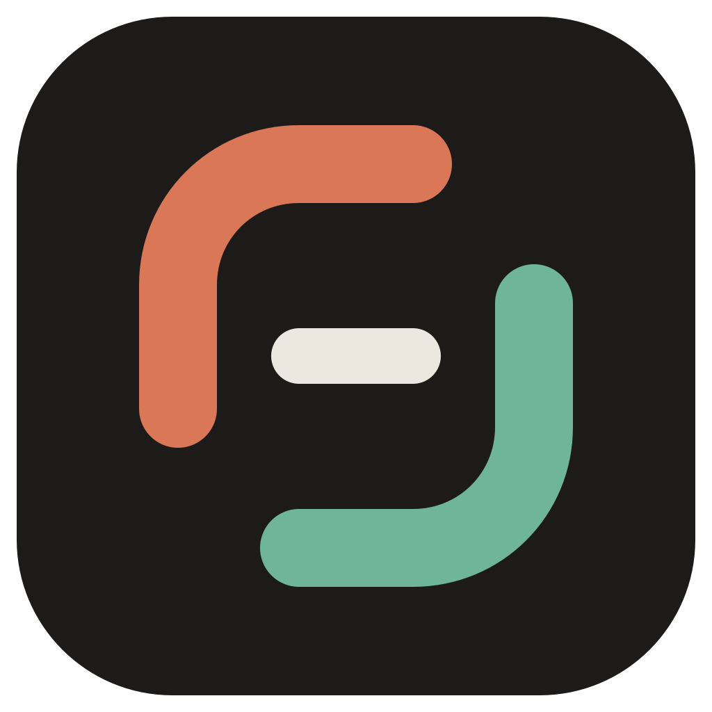
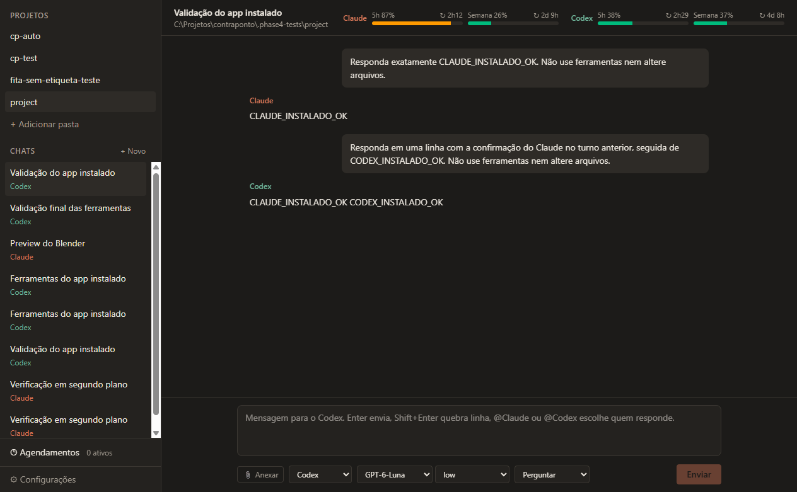
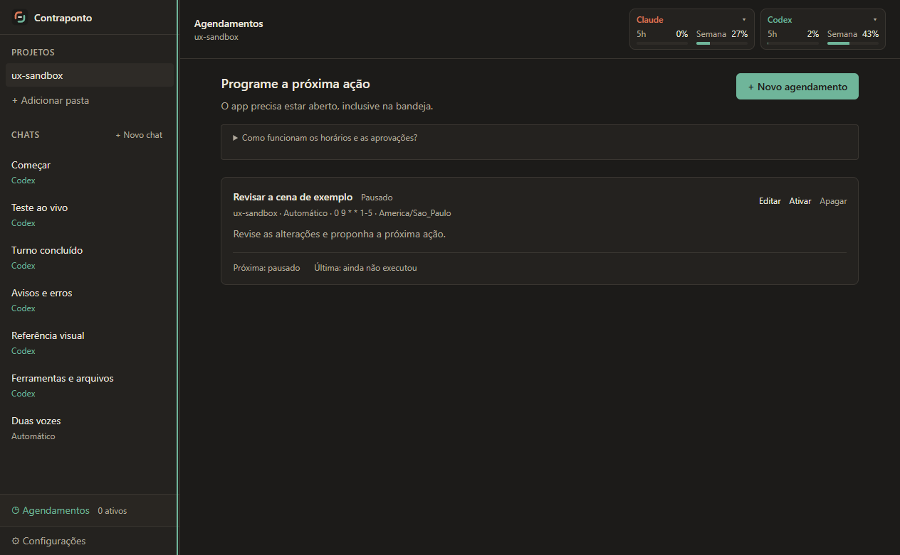

# Fase 4 — Criativo e rotina

Data: 2026-11-15. Repositório: `C:\Projetos\contraponto`.

**Concluída no escopo solicitado**, com 64 testes e typecheck passando. O PLAN foi atualizado. A aprovação para uso do jogo oficial permanece na Fase 3.

## Entregas e verificações

| Item | Entregue | Verificação |
|---|---|---|
| Ícone | SVG original; `build/icon.png` 1024×1024; `build/icon.ico` com 16, 24, 32, 48, 64, 128 e 256 px; janela, bandeja, executável e NSIS configurados | Dimensões de cada imagem do ICO conferidas; PNG inspecionado visualmente; recursos incluídos no pacote |
| Blender | `scripts/blender/render_preview.py`; instruções enviadas ao Claude, ao Codex e às delegações | `tape.glb` da cópia renderizado em Eevee; também renderizado um `.blend` sintético com câmera/luz existentes; hash do `.blend` preservado |
| Previews no chat | Diretório `%APPDATA%\Contraponto\previews`; exibição Markdown existente reaproveitada | PNG de 768×768 carregado como imagem real via `cp-file` no chat instalado, com `naturalWidth=768` |
| Agendamentos | Cron de 5 campos com fuso IANA, intervalo e execução única; projeto, agente/modo, modelos/esforços, permissões e chat novo/existente | Testes com SQLite real e parser real; CRUD conferido pelas APIs normais do app instalado |
| Execução em segundo plano | Mesma fila por pasta do `ChatService`; `powerMonitor.resume`; `powerSaveBlocker` durante o turno | Tarefa real de 1 minuto com Claude/Haiku respondeu `AGENDAMENTO_FASE4_OK` sem janela; resultado recuperado ao reabrir |
| Bandeja | Fechar esconde a janela; menu Abrir/Sair; instância única e reabertura | Fechamento nativo por Alt+F4 confirmado como `document.visibilityState=hidden`; processo permaneceu ativo e reabriu |
| Iniciar com Windows | Opção em Configurações do app instalado | Valor ligado, lido de volta e restaurado ao valor original desligado; nenhum reinício do Windows foi provocado |
| Instalador | electron-builder/NSIS, Windows x64, instalação por usuário com pasta selecionável | Instalado em pasta limpa; binários nativos fora do ASAR; turnos reais das duas IAs, cotas e contexto cruzado conferidos |
| Produção | Costuras de debug/seed removidas por condição de compilação; somente UI local | Inspeção do bundle sem `CONTRAPONTO_DEBUG_PORT`, `CONTRAPONTO_SEED_PROJECT` ou `ELECTRON_RENDERER_URL`; app instalado ignorou variáveis-sentinela e carregou `file:` |
| README | Português, prints reais, requisitos, desenvolvimento, instalador, credenciais e arquitetura | Imagens inspecionadas e caminhos/comandos conferidos |

## Ícone

Duas linhas independentes, coral e verde, se respondem em torno de um compasso comum. O fundo segue `#1c1b19`, com Claude `#d97757` e Codex `#6fb59a`. O desenho evita letras e detalhes pequenos. A fonte editável está em [build/icon.svg](../build/icon.svg); `npm.cmd run icons` regenera PNG e ICO.

## Blender

O script importa `.glb` ou abre `.blend`, calcula o enquadramento por limites da geometria, cria câmera/luzes quando faltam e renderiza em Eevee. Aceita saída PNG e `--size` entre 64 e 2048, com padrão 768. O arquivo de entrada não é salvo.

Preview verificado: `%APPDATA%\Contraponto\previews\phase4-tape-preview.png`. Ele foi gerado a partir de `C:\Projetos\fita-sem-etiqueta-teste\game\assets\models\tape.glb`. A imagem e os arquivos de teste ficam fora do conteúdo versionado do Contraponto. Nenhum script de `tools/blender` do jogo foi usado ou copiado.

As instruções do app informam caminhos absolutos e comandos com aspas, inclusive quando o instalador está em uma pasta com espaços. Os previews usam o diretório de dados do app; não criam diretórios nem arquivos de instrução no projeto de trabalho.

## Agendamentos e comportamento de recuperação

- Migração SQLite guarda tarefas e prazos. O próximo disparo é persistido **antes** de iniciar o trabalho, evitando repetir efeitos de uma execução interrompida.
- Ao voltar da suspensão ou reiniciar o app, cada tarefa atrasada gera um turno; os disparos perdidos não são reproduzidos em sequência.
- Uma tarefa não executa duas vezes ao receber ticks concorrentes. Edições, pausas e exclusões durante um turno não são desfeitas quando ele termina.
- A tarefa passa pela fila do projeto. Continuar um chat ocupado aguarda o turno anterior e aplica o modelo/esforço agendados na hora da execução.
- Aprovações continuam necessárias conforme o nível escolhido. Com janela oculta, o app avisa pela bandeja. Pausar não cancela o turno atual.
- O app não liga nem acorda a máquina. Fechar a janela mantém o serviço na bandeja; Sair encerra o app.

A recuperação foi coberta por relógio controlado, persistência em disco, mudança de horário de verão e reinicialização com tarefa atrasada. A execução sem janela usou as IAs reais. Não foi provocada uma suspensão física do Windows durante esta sessão.

## Instalador e IAs

Instalador final: `C:\Projetos\contraponto\dist\Contraponto-0.1.0-Setup-x64.exe`.

Instalação final: `%LOCALAPPDATA%\Programs\Contraponto` (padrão do instalador por usuário). Dados do app: `%APPDATA%\contraponto`.

Tamanho: **385.286.696 bytes** (aproximadamente 367 MiB). SHA-256: `EBC873719D7B5D1A86675E1065B879FEC7242C67F93FAB1C54D8B41B9B18DDD1`.

Os executáveis de `@anthropic-ai/claude-agent-sdk-win32-x64` e `@openai/codex-win32-x64` ficam em `app.asar.unpacked`. Os resolvedores usam esses arquivos físicos, com as versões do projeto; não há fallback para um Codex global. O preview Python e os ícones são recursos externos do pacote. A inspeção do ASAR não encontrou projetos de teste, evidências da Fase 3 nem arte do jogo.

No aplicativo instalado:

- Claude respondeu `CLAUDE_INSTALADO_OK`.
- Codex respondeu `CLAUDE_INSTALADO_OK CODEX_INSTALADO_OK`, comprovando o resumo cruzado.
- As cotas de 5h e semana das duas IAs carregaram.
- Na instalação final, **sem limpeza externa de ambiente**, Claude criou `installed-claude-final.txt` com `CLAUDE_TOOL_OK` e Codex criou `installed-codex-final.txt` com `CODEX_TOOL_OK` por PowerShell, ambos somente no projeto descartável e com aprovações. Isso valida ferramentas além das respostas de texto.
- A conferência adicional de ferramentas encontrou e corrigiu uma dependência indevida do ambiente do Codex Desktop: variáveis de sessão/identidade do launcher Core estavam sendo herdadas pela CLI independente. O app agora as remove antes de iniciar os agentes, preservando `CODEX_HOME`, certificados, PATH e a restrição de rede. As configurações globais e as credenciais do usuário não foram alteradas. A criação de arquivo via PowerShell voltou a funcionar.

Os ícones foram extraídos tanto do executável instalado quanto do instalador e inspecionados; ambos contêm o desenho do Contraponto. As evidências locais e os scripts de conferência desta sessão ficaram em `.phase4-tests/`, ignorada pelo Git, e foram removidos depois da conferência. As instalações de teste foram desinstaladas. A porta DevTools foi usada somente durante a conferência, com a flag padrão do Electron; a sessão final do app foi aberta sem essa flag.

## Checks e limites

- Antes: **45 testes passando**, `npm.cmd run typecheck` passando.
- Depois: **64 testes passando**, `npm.cmd run typecheck` passando; build de produção e NSIS concluídos.
- Testes novos cobrem prazos, fuso/DST, persistência, recuperação, execução única, concorrência, liberação do bloqueio de energia, editar/pausar/apagar durante execução, vínculo chat/projeto, fila com turnos manuais, instruções Blender, caminhos físicos do ASAR e isolamento do ambiente.
- O npm audit das dependências de produção encontrou **0 vulnerabilidades**. Há **6 alertas moderados na cadeia de ferramentas de build**, derivados de `minimatch` usado pelo electron-builder; não foi feito downgrade automático do empacotador. Essa manutenção fica registrada como pendência.
- O instalador não tem assinatura digital; assinatura/distribuição pública formal ficam para uma decisão posterior. Não foram automatizados avisos de segurança do Windows.
- “Iniciar com o Windows” foi verificado pela configuração efetiva, sem reiniciar o computador. O tratamento de suspensão foi testado pela lógica/persistência, sem suspender fisicamente a máquina.
- A Fase 3 continua com os testes manuais do jogo e a aprovação de uso oficial pendentes. A Fase 4 não autoriza usar a pasta oficial do jogo.

Nenhum commit ou push foi feito nos repositórios de código. Os testes do app usam seus checkpoints internos no repositório-sombra. O jogo original não foi acessado nesta fase; a cópia foi usada apenas como entrada de leitura para o preview. Os agendamentos de teste ficaram pausados e a inicialização automática foi restaurada ao estado original.
